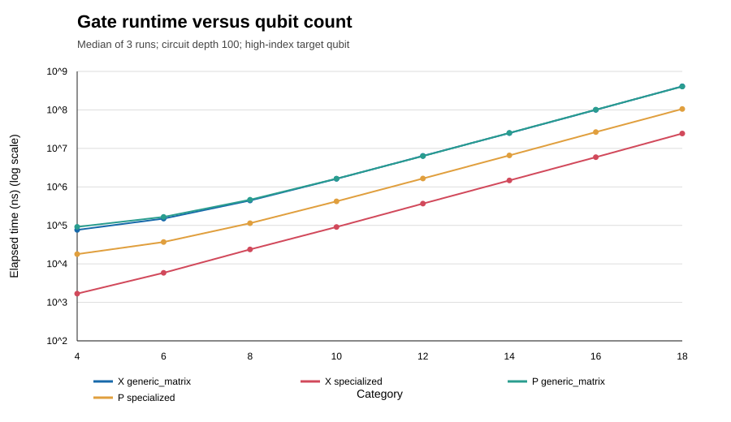
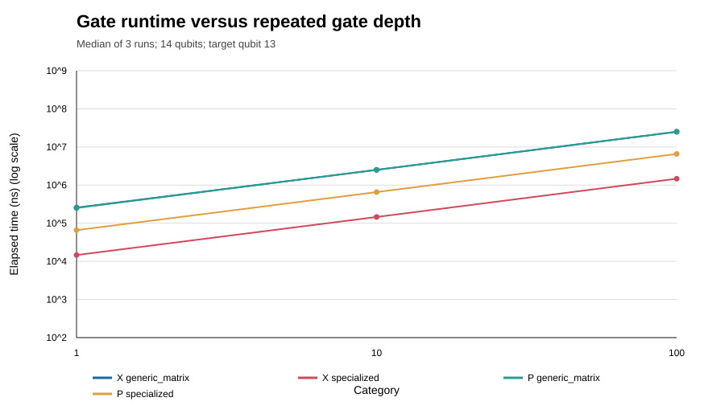
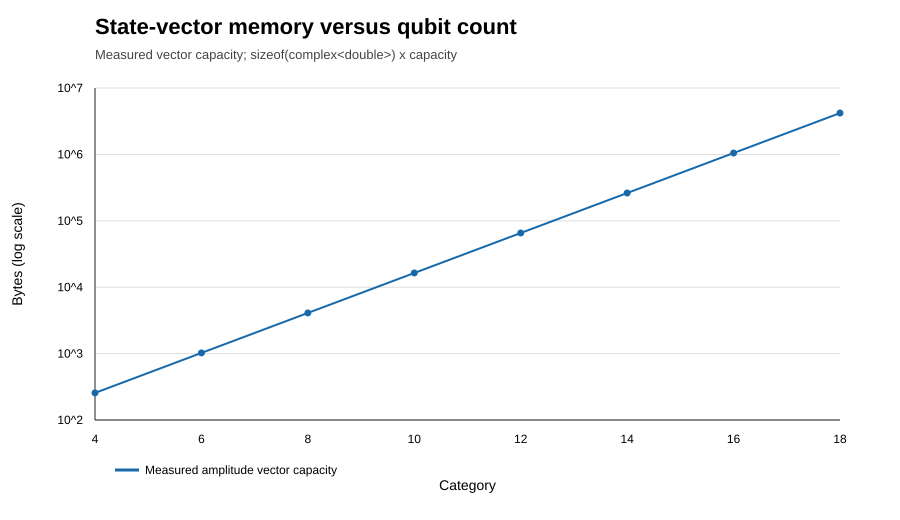
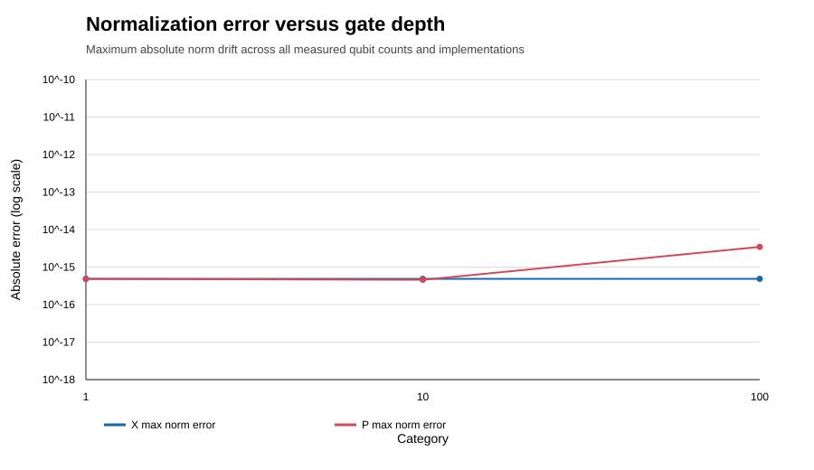

# QuantumSim-C++: A Small State-Vector Simulator and Gate-Application Study

**Technical report**  
**Date:** 2026-10-12  
**Implementation:** C++17, `std::complex<double>`  

## Abstract

This project implements a small pure-state quantum circuit simulator in C++17. It stores the amplitudes of an n-qubit state, applies common single- and multi-qubit gates directly to those amplitudes, computes computational-basis probabilities, and samples seeded measurement outcomes. Analytical checks include single-qubit gate identities and Bell-state correlations; reproducible randomized circuits test normalization. A controlled benchmark compares generic 2x2 matrix application with specialized X and phase-gate loops for 4 to 18 qubits and depths of 1, 10, and 100. In the recorded MinGW GCC 6.3.0 run, specialized X and phase application were faster at 18 qubits and depth 100, while both implementations yielded the same computed state for the measured cases. The largest observed normalization drift was approximately 2.52e-12. The results describe this implementation and environment only.

## 1. Introduction and motivation

A state-vector simulator makes the linear algebra of quantum circuits explicit: the program stores one complex number for each computational-basis state and updates those numbers under unitary operations. This is useful for learning how gate definitions, qubit ordering, numerical precision, and memory scaling meet in working software. It also exposes the main constraint of the full state-vector approach: the number of amplitudes doubles with every additional qubit.

This project is an educational and experimental implementation. It does not claim to outperform established simulators. Other classical simulation approaches can exploit circuit structure such as low treewidth; those methods have different tradeoffs from storing the complete state vector [2].

## 2. Research question and objectives

**Research question:** How do generic matrix and specialized direct-amplitude gate implementations affect runtime, state storage, and numerical error as qubit count and repeated gate depth increase?

Objectives:

1. Implement a reusable C++17 state-vector, gate, circuit, and measurement core.
2. Validate its behavior against analytical results and reproducible randomized checks.
3. Compare generic and specialized implementations under fixed, repeatable circuit inputs.
4. Preserve raw observations and report actual rather than estimated timing results.

## 3. Mathematical background

### 3.1 State vectors and probabilities

An n-qubit pure state is

`|psi> = sum(i=0..2^n-1) a_i |i>`, with `sum_i |a_i|^2 = 1`.

The amplitudes `a_i` are complex. Born's rule assigns probability `|a_i|^2` to computational-basis outcome `i`. A one-qubit state is a vector in a two-dimensional complex space; an n-qubit state belongs to a space of dimension `2^n`. Tensor products combine subsystem states. Entangled states, such as `( |00> + |11> )/sqrt(2)`, cannot be written as a product of independent single-qubit states.

Quantum gates are unitary transformations, so they preserve vector norm. Floating-point arithmetic can introduce small accumulated error, which is why the implementation checks normalization within a tolerance rather than requiring exact equality.

### 3.2 Bit order

The implementation uses little-endian indexing: qubit 0 is bit 0 of the integer basis index. If the bits of index `i` are `b_q`, then `i = sum_q b_q 2^q`; the value of qubit q is `(i >> q) & 1`. Printed labels put the most-significant bit at the left, so for two qubits the vector is `[a_00, a_01, a_10, a_11]`. IBM's Qiskit documentation describes the same convention for integer interpretation and state-vector amplitude indexing [3].

### 3.3 Memory and operation scaling

The state requires `2^n` complex amplitudes. With 16 bytes per `std::complex<double>`, the amplitude buffer is `16 * 2^n` bytes: 20 qubits require 16 MiB; 25 require 512 MiB. A typical single-qubit gate visits `2^(n-1)` amplitude pairs, so its arithmetic work is O(2^n) with O(1) extra working storage. A full dense unitary over n qubits would require O(4^n) matrix entries and is avoided.

## 4. Simulator architecture

- `StateVector` owns the amplitude vector, computational-basis initialization, basis labels, probabilities, normalization checks, and state inspection.
- `Gates` implements one-qubit matrices and direct pair/permutation/phase updates, plus controlled-X, controlled-Z, SWAP, and Toffoli.
- `Circuit` records a sequence of typed operations and replays it from its configured initial basis state.
- `Measurement` computes probability vectors and samples independent basis outcomes with a caller-provided 64-bit seed. Shot sampling does not collapse or mutate the state vector.
- `main.cpp` provides `bell`, `ghz`, and `basis` CLI selections.
- `tests/test_quantumsim.cpp` validates analytical behavior, errors, sampling reproducibility, and randomized circuits.

For the generic single-qubit operation, each pair of basis indices differing only at target bit q is transformed by a 2x2 matrix. The loop keeps the old pair in local variables before writing the new values, so updates do not overwrite an input needed for the same operation. X instead swaps pair entries; diagonal Z/P/RZ gates update phases in place. The controlled gates operate only on basis indices satisfying their control-bit conditions. All these state-update strategies use O(2^n) worst-case traversal and O(1) extra per-state working memory.

## 5. Validation

The generic matrix application validates finite entries and unitarity on each call. Specialized named gates use known unitary matrices and do not repeat that check.

The self-contained test program covers:

- X, Y, Z, H, P(phi), RX, RY, and RZ analytical examples and identities.
- Bell-state amplitudes and the 0.5/0.5 probabilities of `00` and `11`; `01` and `10` have zero probability.
- CNOT control/target bit order, CZ phase, SWAP, and Toffoli truth-table behavior.
- Generic controlled-H behavior on the control-one subspace.
- Circuit re-execution from its configured initial basis state.
- Seeded shot reproducibility and exact shot totals.
- Invalid qubit indices, repeated control/target indices, non-unitary generic matrices, non-finite phase angles, and non-normalized measurement input.
- 50 reproducible random four-qubit circuits of 100 gates each (seed 20240517), checking normalization after each gate.

The validation executable reports the number of individual checks. A successful run on the earlier core completed 5,032 checks. After adding matrix-unitarity checks and generic controlled-H assertions, the final test source compiled cleanly, but Windows Application Control blocked execution of the freshly rebuilt test binary, including an approved escalation attempt. The final suite's pass count is therefore unconfirmed; the earlier 5,032-check run is not presented as validation of the final source revision.

## 6. Experimental methodology

The benchmark initializes each tested state to `|+>^n` using H on each qubit. It then applies X or P(0.371) repeatedly to the highest-index qubit. The generic strategy uses a 2x2 matrix; the specialized strategy uses the direct operation. The tested sizes are 4, 6, 8, 10, 12, 14, 16, and 18 qubits; tested depths are 1, 10, and 100. Each condition has three repeated measurements. Gate applications are timed without state allocation or initialization. Small cases are batched to put at least about one million amplitude positions in each timing interval. On Windows the timer is QueryPerformanceCounter. Reported runtime is the median of the three per-circuit averages.

The environment was Windows with MinGW GCC 6.3.0 and flags `-std=c++17 -O2 -Wall -Wextra -Wpedantic`. The process exposed 12 logical processors; these benchmarks ran single-threaded. The raw CSV has 288 rows. `state_bytes` reports the vector's actual capacity times `sizeof(std::complex<double>)`, excluding executable/runtime memory and temporary sampling buffers. Error measures are absolute norm drift and L2 distance from the generic reference state after the same operation sequence.

## 7. Results

### 7.1 Runtime versus state size and depth

At 18 qubits and depth 100, median results were:

| Gate | Generic matrix | Specialized | Generic / specialized |
|:---|---:|---:|---:|
| X | 410.30 ms | 24.38 ms | 16.83x |
| P(0.371) | 405.20 ms | 105.69 ms | 3.83x |

At 14 qubits, increasing repeated depth from 1 to 10 to 100 gave approximately proportional runtime growth for both strategies. For example, generic X medians were 0.257 ms, 2.511 ms, and 25.01 ms. This matches the repeated-work design of the experiment; it is not a general statement about all circuit scheduling.

### 7.2 Memory scaling

The recorded amplitude-buffer capacities were 256 bytes at 4 qubits, 16 KiB at 10 qubits, 256 KiB at 14 qubits, and 4 MiB at 18 qubits. Adding 14 qubits multiplied the storage by 16,384, exactly the expected `2^14` ratio. These measurements end at 18 qubits; larger values in the memory table are formula-based estimates, not benchmark allocations.

### 7.3 Numerical behavior

Across the measured cases, the maximum observed absolute norm drift after one logical circuit was `3.4556e-15`, for 100 phase-gate applications at 6 qubits. The specialized and generic output vectors had computed L2 distance zero in these runs. This exact match is specific to these gate formulas and operation sequences; it does not establish zero numerical error for arbitrary circuits.

## 8. Discussion and limitations

The generic path also checks matrix unitarity on every call, which adds fixed per-gate work and contributes to the measured difference, especially for small states. This is part of the measured implementation comparison and is a limitation when interpreting the speedup as arithmetic-only.

Specialized operations were faster in this experiment because they avoid generic complex matrix multiplication for each pair. X becomes an amplitude swap; the phase gate multiplies only amplitudes for which the target bit is one. The observed factor varies by gate and size. It reflects implementation details, compiler optimization, the high-index target's memory access pattern, timer batching, and this specific machine.

The benchmark does not compare against an established simulator, use multiple machines, measure process RSS, explore gate fusion, or vary circuit structure. The amplitude-vector size is an exact allocation measurement, but it is not total memory consumption. Only up to 18 qubits were benchmarked; 25 qubits are accepted by the library's hard limit but require about 512 MiB for amplitudes alone. The CLI defaults to rejecting requests above 20 qubits unless `--allow-large` is passed, and reports an estimate first. Simulation results can vary slightly with compiler, architecture, and floating-point implementation.

This implementation supports pure-state unitary evolution and computational-basis sampling. It does not model noise, mixed states, mid-circuit measurement, classical control, GPU execution, or distributed state vectors. Tensor-network methods can exploit circuit structure under conditions such as low graph treewidth [2]; this code does not implement those alternatives.

## 9. Conclusion and future work

The project now provides a complete educational state-vector core, common gates, a circuit and measurement interface, a small CLI, reproducible validation, and an actual-data benchmark. The controlled experiment found faster specialized X and phase paths for its tested conditions, with small normalization drift and no measured difference from the generic reference output. The evidence is limited to this code, build, machine, and experiment.

Future work could add gate fusion, noisy channels, marginal measurement, parameterized circuit files, a second compiler/hardware benchmark, and RSS measurement. Any optimization should be evaluated against the checked-in raw-data methodology and should retain analytical and randomized correctness checks.

## References

1. Nielsen, M. A., & Chuang, I. L. (2010). *Quantum Computation and Quantum Information* (10th anniversary ed.). Cambridge University Press.
2. Markov, I. L., & Shi, Y. (2008). Simulating quantum computation by contracting tensor networks. *SIAM Journal on Computing, 38*(3), 963-981. https://doi.org/10.1137/050644756. Preprint: https://arxiv.org/abs/quant-ph/0511069.
3. IBM Quantum. *Bit-ordering in the Qiskit SDK*. https://quantum.cloud.ibm.com/docs/en/guides/bit-ordering.
